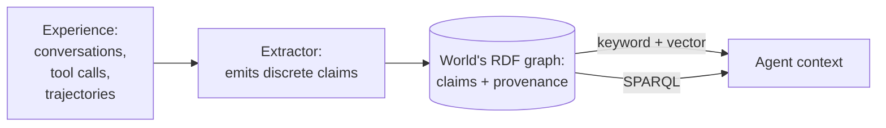
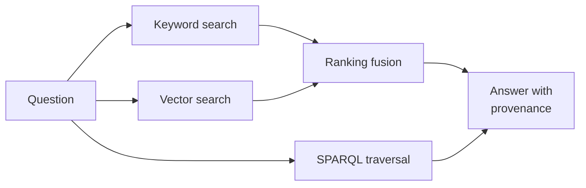

Vector memory retrieves whatever text is most similar to a query and hopes it is
true. Stuffing raw transcripts into context is expensive and equally
unverifiable. The Worlds memory pipeline takes a different route: distill
experience into discrete claims, store each one in a knowledge graph with its
source attached, and let the agent query exactly what it needs.

This guide explains the four stages of that pipeline and what each one buys you.
It pairs with the [neurosymbolic approach](/guides/neurosymbolic) guide, which
covers the write-time boundary in depth (neural networks propose, rules
dispose). Here we follow a claim through the whole loop.

Each claim carries its source, so any fact the agent uses can be traced back and
audited. The sections below walk through the stages.

## Extract: experience becomes claims

The pipeline starts with unstructured experience: conversations, tool calls,
meeting notes, agent trajectories. An extractor (any LLM you configure) reads
the material and emits discrete claims. Each claim is one assertion with a typed
role, for example:

- A task rule: "read_tab requires a tab_index argument."
- A user preference: "the user prefers branches named after the ticket."
- An environment fact: "this repo's CI runs prettier check on every PR."

Claims are small on purpose. One claim, one assertion, so retrieval can fetch
precisely the ones a turn needs and provenance can point at exactly one
statement. Extraction quality is the ceiling on memory quality: whatever the
extractor fails to notice never reaches the graph.

## Ground: provenance on every claim

Each claim lands in the world's RDF graph with its source attached: which
document, conversation, or trajectory it came from. When a claim has been tested
against reality, the evidence records that too, including failed attempts. A
rule that eight trajectories contradicted reads differently from a rule one
trajectory suggested, and the graph keeps both distinguishable.

This is what makes fact checking a property of the memory instead of a separate
process. Asking "why does the agent believe this" is a query, not an archaeology
project. It also enables a pattern that falls out for free: rules with repeated
failed evidence can surface as explicit cautions, so an agent knows not just
what works but what has verifiably failed before.

## Retrieve: three ways in

Stored claims answer to three query surfaces:

- **Keyword search** finds claims whose literals match the words in the
  question. Precise when vocabulary overlaps, brittle when it does not.

- **Vector search** finds conceptually related claims even when the wording
  differs. Good for recall, subject to the usual similarity caveats.

- **SPARQL** answers structural questions exactly: "list every project this
  person manages" is a graph traversal, not a similarity contest. The result is
  deterministic and repeatable.

Hybrid search runs keyword and vector together and fuses the rankings. The
practical split: fuzzy recall goes through search, precise structured questions
go through SPARQL, and the two surfaces cover each other's weak spots.

## Compose instead of stuff

The counterintuitive payoff is that this makes memory smaller, not bigger.
Instead of re-reading full transcripts every turn, the agent keeps the distilled
claim graph and fetches only the claims relevant to the current question.
Context stays short, retrieval stays cheap, and every fact in it carries a
receipt.

The same shape serves a second use: when experience accumulates faster than
curation, the claim graph is what makes pruning, deduplication, and
provenance-weighted selection possible at all. You can only curate memory that
is structured.

## Try it

[Your first query](/worlds/first-query) walks through creating a world,
importing data, and running both search and SPARQL against it. The
[entity resolution guide](/guides/entity-resolution) shows the
resolve-at-write-time pipeline in detail, and
[build a company brain](/guides/company-brain) applies the pipeline to team
knowledge end to end.
